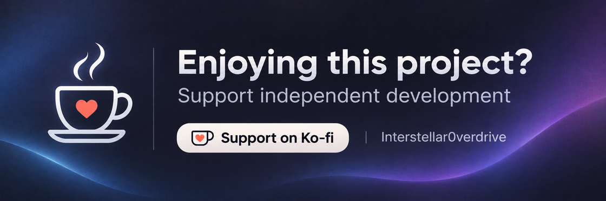

# UGREEN Telemetry MQTT


Experimental, outbound-only telemetry from a UGREEN NAS to Home Assistant through MQTT Discovery.

It installs as one UGOS Docker project. A browser wizard lets you choose the disks, volumes and readings to publish, and how often each one is sent.

<p align="center">
  
  
</p>

> [!WARNING]
> This is a beta prototype, not yet a stable release. It runs every day on my own DXP4800 Pro, but it has not yet been installed by anyone else. See [what has been verified](#current-status) before trying it.

I built this primarily for my own NAS and am sharing it in case it helps someone else. It is a personal project, not an official UGREEN or Home Assistant integration. I cannot promise maintenance, support, compatibility with every model, or a release schedule. Contributions and reports from other devices are welcome. The MIT license allows anyone to fork and adapt the code.

## Why this exists

Other NAS monitoring projects already exist and may be a better fit for many people. For my setup, I wanted a smaller path that keeps the NAS administrator account on the NAS. Home Assistant only connects to the MQTT broker and never receives NAS administrator credentials. This separation was the reason for writing the project, not a criticism of other approaches.

## How it works

One UGOS Docker project runs two containers from the same image:

- **`reader`** reads SMART data from the selected SATA disks and the space on the selected volumes. It has no network, no MQTT password and no web port. It writes a small snapshot to a RAM-backed volume.
- **`setup`** serves the browser wizard on the local network and publishes the selected readings to your MQTT broker with a dedicated login. It has no disk devices and no raw disk access, and runs as an unprivileged user.

<p align="center">
  
  
</p>

Docker fixes device access when a container starts, so a web wizard cannot safely grant itself access to a disk later. Keeping disk access in a container without network is why there are two containers instead of one. The [security model](docs/security-model.md) has the details.

## Current status

Verified on my DXP4800 Pro with UGOS Pro, four SATA HDDs and one data volume:

- the wizard's token login, disk and volume discovery, per-reading intervals, and saved settings, with the MQTT password kept in a separate volume;
- SMART temperatures and counters through the network-isolated reader, without giving the web service any disk access;
- automatic recovery after NAS reboots and power cycles, and after separate restarts of the Mosquitto broker add-on and Home Assistant Core, keeping the same Home Assistant device and entities;
- a code upgrade from `0.3.0.dev1` to `0.3.0.dev2` and a rollback, with settings and entities preserved.

Not verified yet: an installation by another user, an installation and an update from the published image through UGOS, a configuration migration, real two-bay hardware, other UGREEN models, and a reader sample taken while an HDD is actually in standby.

| Reading | Default interval | Home Assistant default |
| :--- | :--- | :--- |
| CPU usage, memory usage | 1 minute | Enabled |
| CPU temperature, SSD/NVMe temperature, HDD temperature, maximum HDD temperature, time of the last HDD reading, volume usage, uptime | 15 minutes | Enabled |
| Supported HDD SMART counters | 15 minutes, off until chosen in the wizard | Disabled; opt in per entity |

Each reading group has its own interval in the wizard. SMART-based groups have a five-minute minimum. The number of readings depends on the selected disks, mounted volumes, and sensors exposed by the NAS. A missing SMART attribute does not appear as zero.

The wizard follows the browser's light or dark theme and adapts to phone screens. These screenshots show the real wizard running with example data.

<p align="center">
  
  
</p>

## Install

The project is published as a container image on GitHub Container Registry, and UGOS Docker downloads it from a short Compose file. The [installation guide](docs/installation.md) walks through creating the UGOS Docker project, opening the wizard, and checking the result. Read the code first: the wizard and publisher are in [`src/ugreen_telemetry/`](src/ugreen_telemetry/), and the disk reader uses [`host-smart-snapshot.py`](host-smart-snapshot.py).

The [release and update policy](docs/release-and-updates.md) explains image tags and updates.

## Behavior after restarts

Both containers use `restart: unless-stopped`, so Docker starts them again after a NAS reboot. Settings and the MQTT password live in named Docker volumes; the reader's snapshot is rebuilt in RAM after each restart, and HDD readings return with the next sample. The publisher reconnects when the broker comes back. See [restart and storage notes](docs/restarts-and-storage.md).

## Storage and load

The publisher retains only the latest MQTT values, rather than an ever-growing MQTT time series. Home Assistant's Recorder stores changed sensor states in its database; its default detailed-history retention is 10 days, while eligible hourly long-term statistics are kept until removed. Repeated unchanged MQTT values are filtered by Home Assistant because this project does not set `force_update`. On the tested four-HDD setup, two sensors publish once a minute and eleven active sensors every 15 minutes. That is at most 3,936 state publications per day, not necessarily 3,936 Recorder writes. Check your own Recorder configuration and database growth if you have changed its defaults. [Restart and storage notes](docs/restarts-and-storage.md) explain the estimate and how to opt out of recording particular entities.

## Security and limitations

The setup page uses local HTTP, so the setup token and MQTT password cross the LAN unencrypted while you configure it. Use it only on a trusted network and never expose its port to the Internet. MQTT without TLS also sends the password in clear text; use TLS on an untrusted network and verify any broker ACL you rely on. See the [security model](docs/security-model.md).

The reader runs `smartctl -d sat -n standby,0 -A`, which asks the disk to skip the reading while it sleeps, but controller behavior varies. See [monitoring impact](docs/monitoring-impact.md) to check it on your own NAS.

If Home Assistant already knows a NAS with the same NAS ID, it keeps the existing entities and their enabled/disabled choices. Use Home Assistant's multi-select entity action to disable diagnostic counters you don't need.

## Repository layout

| Path | Purpose |
| :--- | :--- |
| `src/ugreen_telemetry/` | Setup wizard, reader schedule, and MQTT publisher |
| `host-smart-snapshot.py` | SMART and volume sampling used by the reader |
| `compose.ugos.ghcr.yaml` | UGOS Docker project using the published image |
| `compose.ugos.yaml` | UGOS Docker project that builds the image from source |
| `Dockerfile` | Container image shared by both services |
| `.github/workflows/` | Tests and GHCR image publication on release |
| `tests/` | Simulated sensor, wizard, reader, and MQTT tests |
| `tools/docs_screenshots/`, `tools/docs_architecture.py` | Regenerate the documentation screenshots from the real wizard, and the architecture diagram |
| `docs/` | Installation, restarts, security, impact, and release notes |

Run local tests with:

```sh
PYTHONPATH=src python3 -m unittest discover -s tests -v
```

See [contributing](CONTRIBUTING.md) before sharing test output. Do not post credentials, disk serial numbers, full SMART dumps, or personal paths.

---

<p align="center">
<a href="https://ko-fi.com/Interstellar0verdrive">
<picture>
  <source media="(prefers-color-scheme: light)" srcset="docs/images/support-kofi-light.webp">
  
</picture>
</a>
</p>
