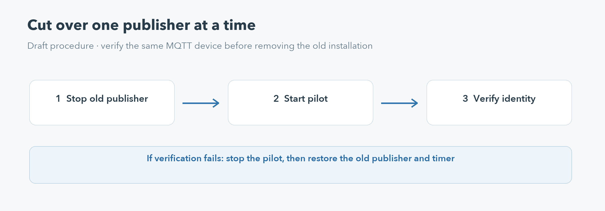

# Moving from the host installer to the UGOS Docker project

This remains a **draft migration plan**, not a tested release procedure. A reversible two-service pilot was connected to the live Home Assistant broker on October 27, 2026. The old publisher and host snapshot timer remain stopped; after the NAS reboot, the user verified the timer was still `disabled` and `inactive`. The isolated test project remains available. A local upgrade from `0.3.0.dev1` to `0.3.0.dev2` and rollback passed, as did a private GHCR image switch and rollback. A public release update, configuration migrations, and a fresh user installation still need validation before treating this as a release procedure.

*The sequence is a planning aid, not a completed migration procedure.*

The pilot reused NAS ID `dxp4800pro` and the existing `DXP4800 Pro` MQTT device. After an initial reader snapshot delay, Home Assistant received new CPU, memory, and all four HDD temperature values on the historical entity IDs. Restarting the pilot setup/MQTT container preserved its configuration. After separate NAS, broker add-on, and Home Assistant Core restarts, publication resumed on the same device with 38 entities and no duplicate. The two historical volume entities remain disabled by user preference; MQTT Explorer confirmed the candidate's `data` available-space and used-percent topics have retained states and `online` availability.

On October 26, 2026, a read-only comparison of the historical Home Assistant MQTT registry and the isolated broker log confirmed that all four HDD temperature keys match (`sda`–`sdd`). The historical NAS ID is `dxp4800pro`, while the isolated test still uses `ugreen-isolated-test`; set the real-broker configuration to the historical NAS ID before publishing there. The candidate uses volume label `data`, matching the historical `volume_data` entity. An older `volume_data1` entity also remains in the registry and should be reviewed separately after the pilot.

The October 27 read-only check of the live isolated wizard confirmed `ugreen-isolated-test`, MQTT host `broker` (the internal test broker), four selected HDDs, one selected volume and six enabled reading groups. Its saved password was not inspected. The wizard exposes **Stable NAS ID** as an editable field, and saving restarts the MQTT publisher. Do not save a real-broker NAS ID in the isolated project as an identity check; the controlled cutover is the point to change it.

## Before the cutover

1. Record the existing NAS ID, Home Assistant device name, selected disk names, volume labels, and active sensor names. Keep the old installation files, Docker project, and MQTT login available for rollback. Do not copy passwords into notes or screenshots.
2. Check that the candidate image reports fresh readings from the selected disks while they are active. Confirm its reader has no network access and its setup/MQTT service has no raw disk capability.
3. Confirm that the candidate uses the same NAS ID as the old publisher. It must derive the same HDD IDs from the host sysfs paths. For `/volume1`, the new wizard uses the label `data`, matching the default host-installation label on the tested NAS. Check any custom volume labels separately.
4. Compare the expected MQTT Discovery topics and `unique_id` values against the existing device. A mismatch may create duplicate entities. Do not delete retained Discovery topics or the old Home Assistant device as a shortcut.
5. Use NAS ID `dxp4800pro` and display name `DXP4800 Pro` for this NAS. Preserve the current four HDD selections and the `/volume1` → `data` mapping. Keep the two reading groups that are currently off (SSD/NVMe temperatures and HDD diagnostics) off for the first pilot; change the published set only after the identity check. The retained historical `data1` and other stale Discovery entries are a separate cleanup task.
6. Prepare a **two-service** Compose project using the reviewed image: network-isolated `reader` and networked `setup`/MQTT service. The internal Mosquitto `broker` service belongs only to the isolated test project. Pick an unused setup port before deployment and keep the test project's named configuration and secret volumes separate from the real-broker pilot. A fresh pilot setup token and dedicated MQTT password must be entered locally by the NAS owner; do not copy the disposable broker password.

## Cut over one publisher at a time

1. Stop and disable the old host snapshot timer. Stop the old MQTT publisher container. Verify both are inactive. Leave their files and Compose project in place.
2. If the old Home Assistant device is temporarily disabled because its entities are unavailable, leave it disabled until the new publisher has been checked on MQTT. Disabling a device is different from deleting its MQTT Discovery topics.
3. Stop the isolated test project, including its disposable broker, without deleting its named volumes or project files. Verify that its reader and publisher are stopped. Start the separate two-service pilot project from the reviewed image. Enter the dedicated MQTT credentials in the local setup wizard; never put the password in Compose, a URL, a log, or a GitHub issue.
4. Verify on the broker that the candidate publishes fresh sensor states and retained Discovery configuration under the expected NAS ID. Check at least one HDD temperature, CPU and memory usage, and a volume reading. Check that obsolete sensor keys are not unexpectedly advertised.
5. Re-enable the existing Home Assistant device. Confirm that the expected entities update, that old diagnostic enable/disable choices remain sensible, and that no duplicate device or volume entities appeared. Check the history of at least one unchanged entity ID.
6. Verify recovery after NAS, broker, and Home Assistant restarts. On October 27, 2026 these were tested separately on the pilot, followed by a small local two-code-version upgrade and rollback. A later private GHCR image switch and rollback also passed. Keep the old installation as a rollback option until a public release update and any needed configuration migration are verified.

## Roll back

Stop the new project's setup/MQTT and reader services first. Re-enable and start the old host snapshot timer, then start only the old MQTT publisher container. Check that fresh readings return under the original Home Assistant device. Keep only one MQTT publisher active for a given NAS ID at any time.

Do not remove the old files, clear retained Discovery topics, or purge Home Assistant history during a reversible pilot. Make those cleanup decisions separately after the new path has run reliably.
